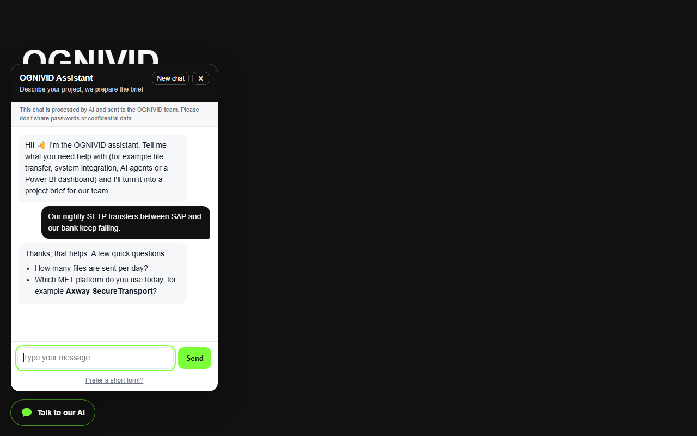

# OGNIVID AI Assistant

WordPress plugin: an AI intake assistant that interviews website visitors about their project and delivers a structured **Project Brief** (HTML email + PDF) to the site owner. Built for [ognivid.com](https://ognivid.com/).

📖 **Documentation:** [English](https://diimasogan.github.io/ognivid-ai-assistant/docs/OGNIVID-AI-Assistant-Documentation.html) · [Bahasa Indonesia](https://diimasogan.github.io/ognivid-ai-assistant/docs/id/OGNIVID-AI-Assistant-Dokumentasi.html)
▶️ **Live mockup:** [try the assistant in your browser](https://diimasogan.github.io/ognivid-ai-assistant/demo/) (simulated AI, nothing is sent)
⬇️ **Download:** [`ognivid-ai-assistant.zip`](https://github.com/diimasogan/ognivid-ai-assistant/releases/latest/download/ognivid-ai-assistant.zip) (latest release)



## Features

- **Consultative AI interview**: short, focused questions, then a summary the visitor confirms before anything is sent.
- **Structured brief** (16 fields) produced through a strict tool schema and re-validated on the server.
- **Delivery**: HTML email with PDF to the owner (with transcript) and a copy to the customer (with a WhatsApp link).
- **Admin inbox** (wp-admin → *AI Briefs*): customer, urgency, source and status columns, unread badge, status filter, transcript, PDF download, internal notes, one-click reply by email or WhatsApp.
- **Bilingual** (English / Indonesian), following the page language.
- **9 AI providers**: Anthropic Claude (default), OpenAI (ChatGPT models), Google Gemini, Mistral, DeepSeek, xAI Grok, Groq, OpenRouter, or any OpenAI-compatible endpoint, plus a form-only mode.
- **Never loses a lead**: automatic form fallback when AI is off, out of credit, failing or over the daily limit.
- **Safeguards**: server-side conversation state, same-origin check, per-conversation / per-IP / daily limits, honeypot, test mode, private PDF storage.

## Upload the plugin to WordPress

1. Download **`ognivid-ai-assistant.zip`** from the [latest release](https://github.com/diimasogan/ognivid-ai-assistant/releases/latest).
   > Use the release ZIP rather than GitHub's green *Code → Download ZIP* button: the release ZIP has the correct folder name and contains only the plugin files.
2. Log in to **wp-admin** and go to **Plugins → Add New Plugin → Upload Plugin**.
3. Click **Choose File**, select `ognivid-ai-assistant.zip`, then **Install Now**.
4. Click **Activate Plugin**. A new **AI Briefs** menu appears in the sidebar.
5. **Updating to a new version:** upload the new ZIP the same way and choose **Replace current with uploaded**. Settings and saved briefs are kept.

Alternative for developers: `git clone https://github.com/diimasogan/ognivid-ai-assistant.git wp-content/plugins/ognivid-ai-assistant`

Requirements: WordPress 6.x, PHP 7.4+ (tested on PHP 8.2), outbound HTTPS, working email delivery (for example the WP Mail SMTP plugin).

## Set it up

1. Open **Settings → OGNIVID AI Assistant**. The plugin starts in **test mode**: only logged-in administrators see the widget.
2. Choose an **AI provider**, paste its **API key** and type a **model ID** from that provider (default: `claude-opus-5-5`). Leave the key empty to run in form-only mode.
3. Set **Send briefs to** (your inbox) and your **WhatsApp number**, choose the button position, and adjust the limits if needed. Click **Save Changes**.
4. Open your site while logged in, send a test message or a test form, and check that the brief arrives by email and in **AI Briefs**.
5. Untick **Test mode** and save. The assistant is now live for every visitor.

| Provider | Where to get an API key | Model ID |
|---|---|---|
| Anthropic Claude (recommended) | console.anthropic.com → API Keys | `claude-opus-5-5` (best), `claude-sonnet-5-5`, `claude-haiku-5-5` (cheapest) |
| OpenAI (ChatGPT models) | platform.openai.com → API keys | a GPT model ID from your OpenAI account |
| Google Gemini | aistudio.google.com → Get API key | a Gemini model ID |
| Mistral AI | console.mistral.ai → API keys | a Mistral model ID |
| DeepSeek | platform.deepseek.com → API keys | a DeepSeek model ID |
| xAI (Grok) | console.x.ai → API keys | a Grok model ID |
| Groq | console.groq.com → API Keys | an open-source model ID hosted on Groq |
| OpenRouter | openrouter.ai → Keys | any model on OpenRouter (GPT, Claude, Llama, …) |
| Custom | your provider | any OpenAI-compatible `/chat/completions` endpoint |
| Off | none | form only, free |

> A ChatGPT Plus or Claude Pro subscription does **not** include API access. Each provider bills API usage separately; set a monthly spend limit in its console.

## How to use

**Visitors**
1. Click **Talk to our AI** (bottom left) on any page.
2. Describe the project and answer the assistant's questions, or click **Prefer a short form?** to fill in a form instead.
3. Confirm the summary. A reference number appears on screen and a copy of the brief arrives by email.

**Site owner**
1. A new brief arrives in your inbox with the PDF attached, and appears in **wp-admin → AI Briefs** with a number badge in the menu.
2. Open the brief to read it (it is marked as read), download the PDF and read the conversation transcript.
3. Use **Reply by email** or **Chat on WhatsApp** in the **Follow-up** box, set the status (*Contacted, Proposal sent, Won, Closed*) and add an internal note, then click **Update**.
4. Use the status filter above the list to see only new or open briefs.

## Project structure

```
ognivid-ai-assistant.php          Plugin bootstrap and hooks
includes/class-oaa-settings.php   Settings page, defaults, sanitising
includes/class-oaa-provider.php   Provider registry, system prompt, brief schema, Claude + OpenAI-compatible adapters
includes/class-oaa-chat.php       REST endpoints, sessions, limits, widget loading
includes/class-oaa-brief.php      AI Briefs post type and admin inbox, PDF, HTML email
includes/fpdf/                    FPDF 1.9 (PDF generation, own licence)
assets/widget.js, widget.css      Chat + form UI (no dependencies)
demo/index.html                   Live mockup (real widget + simulated backend, runs on GitHub Pages)
docs/                             Bilingual HTML documentation (built by docs/_source/build_docs.py)
```

Rebuild the documentation after editing `docs/_source/build_docs.py`:

```bash
python3 -I docs/_source/build_docs.py
```

## REST API

| Endpoint | Body | Response |
|---|---|---|
| `POST /wp-json/ognivid-ai/v1/chat` | `{ sid, message, lang }` | `{ sid, reply, done, mode }` |
| `POST /wp-json/ognivid-ai/v1/form` | `{ name, email, problem, … , lang, ts, website }` | `{ ok, reply }` |

Same-origin requests only; in test mode an administrator session (REST nonce) is required.

---

## Bahasa Indonesia

Plugin WordPress berisi asisten AI yang mewawancarai pengunjung website tentang proyek mereka, lalu mengirim **Project Brief** terstruktur (email HTML + PDF) ke pemilik situs. Dibuat untuk [ognivid.com](https://ognivid.com/).

### Upload plugin ke WordPress
1. Unduh **`ognivid-ai-assistant.zip`** dari [rilis terbaru](https://github.com/diimasogan/ognivid-ai-assistant/releases/latest). Pakai ZIP dari rilis, bukan tombol hijau *Code → Download ZIP*, supaya nama foldernya benar dan isinya hanya file plugin.
2. Login ke **wp-admin**, buka **Plugins → Add New Plugin → Upload Plugin**.
3. Klik **Choose File**, pilih `ognivid-ai-assistant.zip`, lalu **Install Now**.
4. Klik **Activate Plugin**. Menu baru **AI Briefs** muncul di sidebar.
5. **Update ke versi baru:** unggah ZIP baru dengan cara yang sama lalu pilih **Replace current with uploaded**. Pengaturan dan brief yang tersimpan tetap ada.

### Pengaturan awal
1. Buka **Settings → OGNIVID AI Assistant**. Plugin dimulai dalam **mode uji** (hanya admin yang melihat widget).
2. Pilih **penyedia AI** (Claude, OpenAI/ChatGPT, Gemini, Mistral, DeepSeek, xAI, Groq, OpenRouter, atau kustom), tempel **API key**-nya, dan isi **ID model** dari penyedia tersebut. Kosongkan key untuk mode formulir saja.
3. Isi **Send briefs to** (email Anda) dan **nomor WhatsApp**, lalu **Save Changes**.
4. Uji satu pesan atau formulir sebagai admin, pastikan brief masuk ke email dan ke **AI Briefs**.
5. Hilangkan centang **Test mode** dan simpan. Asisten aktif untuk semua pengunjung.

Langganan ChatGPT Plus atau Claude Pro **tidak** termasuk akses API. Setiap penyedia menagih pemakaian API secara terpisah.

### Cara penggunaan
- **Pengunjung:** klik **Konsultasi dengan AI** (kiri bawah), ceritakan proyeknya atau pilih **Lebih suka isi formulir?**, lalu konfirmasi ringkasan. Nomor referensi muncul di layar dan salinan brief dikirim ke email.
- **Pemilik situs:** brief baru masuk ke email (dengan PDF) dan ke **wp-admin → AI Briefs** (ada angka di menu). Buka brief, unduh PDF, baca transkrip, balas lewat **Reply by email** / **Chat on WhatsApp**, lalu atur status dan catatan internal di kotak **Follow-up**.

Coba langsung: [live mockup](https://diimasogan.github.io/ognivid-ai-assistant/demo/?lang=id) (AI disimulasikan, tidak ada data yang dikirim). Panduan lengkap: [dokumentasi bahasa Indonesia](https://diimasogan.github.io/ognivid-ai-assistant/docs/id/OGNIVID-AI-Assistant-Dokumentasi.html).

## License

GPL-2.0-or-later. Bundled [FPDF](http://www.fpdf.org/) is distributed under its own permissive licence (`includes/fpdf/license.txt`).
