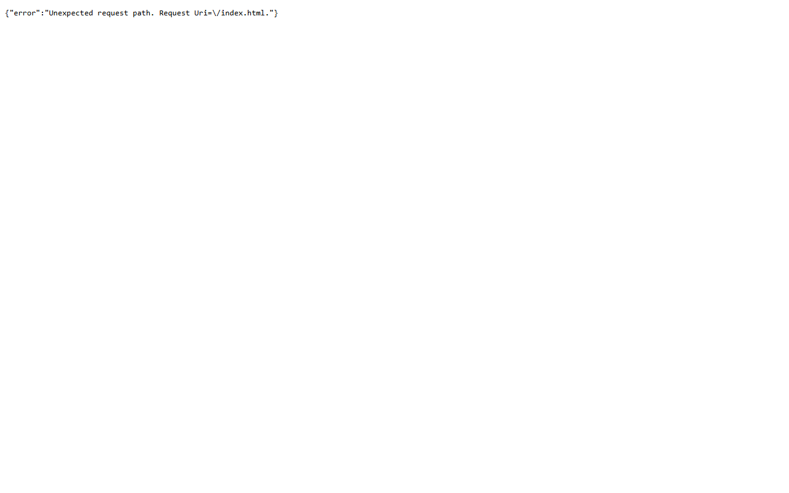

# OGNIVID AI Assistant

WordPress plugin: an AI intake assistant that interviews website visitors about their project and delivers a structured **Project Brief** (HTML email + PDF) to the site owner. Built for [ognivid.com](https://ognivid.com/).

📖 **Documentation:** [English](https://diimasogan.github.io/ognivid-ai-assistant/docs/OGNIVID-AI-Assistant-Documentation.html) · [Bahasa Indonesia](https://diimasogan.github.io/ognivid-ai-assistant/docs/id/OGNIVID-AI-Assistant-Dokumentasi.html)



## Features

- **Consultative AI interview**: short, focused questions, then a summary the visitor confirms before anything is sent.
- **Structured brief** (16 fields) produced through a strict tool schema and re-validated on the server.
- **Delivery**: HTML email with PDF to the owner (with transcript), a copy to the customer (with a WhatsApp link), and a private archive in wp-admin → *AI Briefs*.
- **Bilingual** (English / Indonesian), following the page language.
- **Provider-agnostic**: Anthropic Claude by default (`claude-opus-5-5`), or Gemini, Groq, OpenRouter, or any OpenAI-compatible endpoint.
- **Never loses a lead**: automatic form fallback when AI is off, out of credit, failing or over the daily limit.
- **Safeguards**: server-side conversation state, same-origin check, per-conversation / per-IP / daily limits, honeypot, test mode, private PDF storage.

## Installation

1. Download this repository as a ZIP (or clone it into `wp-content/plugins/ognivid-ai-assistant`).
2. In wp-admin: **Plugins → Add New → Upload Plugin**, then activate **OGNIVID AI Assistant**.
3. Open **Settings → OGNIVID AI Assistant**. The plugin starts in **test mode** (administrators only).
4. Paste an Anthropic API key (console.anthropic.com → API Keys) and set the recipient email. Without a key the assistant runs in form mode.
5. Make sure WordPress can send email (e.g. WP Mail SMTP), test a brief, then switch test mode off.

Requirements: WordPress 6.x, PHP 7.4+ (tested on PHP 8.2), outbound HTTPS, working email delivery.

## Project structure

```
ognivid-ai-assistant.php          Plugin bootstrap and hooks
includes/class-oaa-settings.php   Settings page, defaults, sanitising
includes/class-oaa-provider.php   System prompt, brief schema, Claude + OpenAI-compatible adapters
includes/class-oaa-chat.php       REST endpoints, sessions, limits, widget loading
includes/class-oaa-brief.php      AI Briefs post type, PDF, HTML email, admin view
includes/fpdf/                    FPDF 1.9 (PDF generation, own licence)
assets/widget.js, widget.css      Chat + form UI (no dependencies)
docs/                             Bilingual HTML documentation (built by docs/_source/build_docs.py)
```

Rebuild the documentation after editing `docs/_source/build_docs.py`:

```bash
python3 -I docs/_source/build_docs.py
```

## REST API

| Endpoint | Body | Response |
|---|---|---|
| `POST /wp-json/ognivid-ai/v1/chat` | `{ sid, message, lang }` | `{ sid, reply, done, mode }` |
| `POST /wp-json/ognivid-ai/v1/form` | `{ name, email, problem, … , lang, ts, website }` | `{ ok, reply }` |

Same-origin requests only; in test mode an administrator session (REST nonce) is required.

---

## Bahasa Indonesia

Plugin WordPress berisi asisten AI yang mewawancarai pengunjung website tentang proyek mereka, lalu mengirim **Project Brief** terstruktur (email HTML + PDF) ke pemilik situs. Dibuat untuk [ognivid.com](https://ognivid.com/).

- **Wawancara AI yang konsultatif**: pertanyaan singkat dan terarah, lalu ringkasan yang dikonfirmasi pengunjung sebelum dikirim.
- **Brief terstruktur** (16 kolom) lewat skema tool yang ketat dan divalidasi ulang di server.
- **Pengiriman**: email HTML + PDF ke pemilik (beserta transkrip), salinan ke pelanggan (beserta link WhatsApp), dan arsip privat di wp-admin → *AI Briefs*.
- **Dua bahasa** (Inggris / Indonesia), mengikuti bahasa halaman.
- **Tidak terkunci ke satu penyedia**: Claude secara bawaan, atau Gemini, Groq, OpenRouter, maupun endpoint OpenAI-compatible lain.
- **Tidak kehilangan calon klien**: otomatis beralih ke formulir saat AI mati, saldo habis, error, atau batas harian tercapai.

**Instalasi:** unggah ZIP repository ini di **Plugins → Add New → Upload Plugin**, aktifkan, lalu atur di **Settings → OGNIVID AI Assistant**. Plugin dimulai dalam mode uji (hanya admin). Panduan lengkap ada di [dokumentasi bahasa Indonesia](https://diimasogan.github.io/ognivid-ai-assistant/docs/id/OGNIVID-AI-Assistant-Dokumentasi.html).

## License

GPL-2.0-or-later. Bundled [FPDF](http://www.fpdf.org/) is distributed under its own permissive licence (`includes/fpdf/license.txt`).
